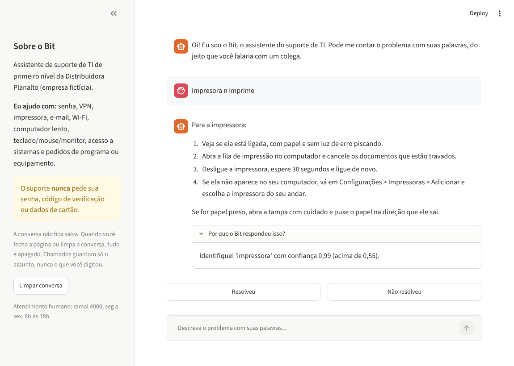

# Bit - Chatbot de Suporte de TI

O Bit é um chatbot de suporte de TI de primeiro nível. A pessoa descreve o problema do jeito que falaria com um colega ("a vpn n conecta", "impressora travou") e o Bit responde com um passo a passo. Quando não resolve, ele abre um chamado para alguém do suporte. O cenário é o setor de TI de uma empresa fictícia, a Distribuidora Planalto.

Projeto final da Unidade IV (Agentes e Ética) da disciplina Tendências em Ciência da Computação.

| | |
|---|---|
| **Aluno** | Davi Vieira Lima |
| **RGM** | 39538061 |
| **Professora** | Kadidja Valéria |
| **Instituição** | UDF Centro Universitário |
| **Ferramenta de IA usada como apoio** | Claude |

**Versão online:** https://davilima11.github.io/Helpdesk/ (dá para conversar com o Bit e ler a documentação direto no navegador, sem instalar nada)



## O que o Bit faz

Ajuda com senha bloqueada, VPN, impressora, e-mail, Wi-Fi, computador lento, teclado/mouse/monitor, pedido de acesso a sistema e pedido de programa ou equipamento. Também consulta o status de um chamado pelo número do protocolo.

O que ele **não** faz é tão importante quanto: não pede senha (e apaga a mensagem se a pessoa digitar uma), não acessa nenhum sistema da empresa, não troca senha nem libera acesso sozinho e não guarda a conversa depois que ela acaba. Se a pessoa falar em vírus, link suspeito ou invasão, ele não tenta resolver: abre um chamado urgente na hora.

## Como rodar

Precisa de Python 3.10 ou mais novo.

```bash
pip install -r requirements.txt
streamlit run app.py
```

Para abrir a versão web no computador (a mesma do site):

```bash
python -m http.server
# depois abra http://localhost:8000
```

Para rodar os testes:

```bash
python -m pytest
python -m tests.calibrar_limiar   # mostra como escolhi o limiar de confiança
```

## Onde está cada entrega

| Entrega da Unidade IV | Onde está |
|---|---|
| Criação de agente de IA | [docs/2-arquitetura-do-agente.md](docs/2-arquitetura-do-agente.md) e a pasta `bot/` |
| Chatbot com a especificação | [docs/1-especificacao.md](docs/1-especificacao.md) e `app.py` |
| Viés algorítmico e responsabilidade social | [docs/3-etica-e-vies.md](docs/3-etica-e-vies.md) |
| Projeto final (solução aplicada) | este repositório, com os testes em [docs/4-testes.md](docs/4-testes.md) |

A documentação segue o fluxo de trabalho de chatbots do SERPRO (entender a necessidade, persona, acervo, modelagem, UX writing, testes e curadoria), adaptado para o tamanho de um projeto de disciplina.

## Estrutura

```
app.py                     interface em Streamlit
index.html, web/           versão web (GitHub Pages), a mesma lógica em JavaScript
bot/
  agente.py                as 4 camadas do agente (perceber, entender, decidir, executar)
  memoria.py               memória curta e média
  privacidade.py           detecção de senha, código, CPF e cartão
  chamados.py              chamados e feedback em SQLite
data/base_conhecimento.json   intenções, exemplos e respostas
tests/                     testes com pytest e script de calibração
docs/                      especificação, arquitetura, ética e testes
```

## Tecnologias

Python, Streamlit, scikit-learn (TF-IDF com n-gramas de caractere e similaridade de cosseno), SQLite e pytest. Não usa API paga nem modelo de linguagem externo. Escolhi assim de propósito, e a explicação está na arquitetura.

A versão web usa só HTML, CSS e JavaScript, mais a biblioteca marked para mostrar a documentação.
