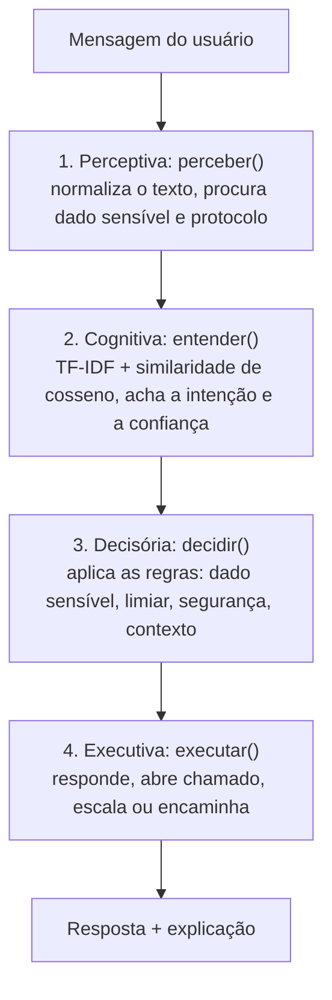

# Arquitetura do agente

## Por que o Bit é um agente e não só um gerador de texto

No guia da Unidade IV, a diferença entre modelo generativo e agente está em quatro pontos: ação, foco, contexto e autonomia. Comparando com o Bit:

| | Modelo generativo | Bit |
|---|---|---|
| Ação | Responde a um prompt isolado | Decide entre responder, perguntar, abrir chamado ou escalar |
| Foco | Gerar texto | Resolver o problema ou entregar para quem resolve |
| Contexto | Não lembra da conversa | Lembra do problema da sessão ("não funcionou" sabe do que se trata) |
| Autonomia | Nenhuma | Pequena e controlada: só abre chamado, nunca mexe em sistema |

A autonomia do Bit é baixa de propósito. Ele age no mundo (abre chamado, marca prioridade alta), mas qualquer ação que mexa em conta ou acesso fica com uma pessoa. Como o guia fala, mais autonomia exige mais responsabilidade ética, e para um primeiro atendimento não vale o risco.

## As 4 camadas

Cada camada é um método da classe `Agente` em `bot/agente.py`.

**Perceptiva.** Recebe o texto, passa para minúsculas, tira acento e pontuação e troca abreviações pela forma completa ("n" vira "nao", "pc" vira "computador"). Aqui também é procurado dado sensível (senha, código de verificação, CPF, cartão) e número de protocolo. Se tiver dado sensível, a mensagem nem chega na camada seguinte.

**Cognitiva.** Transforma o texto em vetor com TF-IDF usando pedaços de 2 a 4 letras (n-gramas de caractere) em vez de palavras inteiras. Escolhi assim porque "impresora" e "impressora" têm quase todos os pedaços iguais, então erro de digitação atrapalha pouco. Depois compara com todos os exemplos da base por similaridade de cosseno e fica com o mais parecido. O resultado é uma intenção e um número de confiança entre 0 e 1.

**Decisória.** É onde ficam as regras, na ordem:

1. Tem dado sensível? Descarta a mensagem.
2. Tem número de protocolo? Consulta o chamado.
3. Confiança abaixo de 0,35? Admite que não entendeu.
4. É segurança? Escala, mesmo com confiança média.
5. É "não funcionou"? Se sabe qual era o problema, abre chamado. Se não sabe, pergunta.
6. Confiança entre 0,35 e 0,55? Responde, mas avisa que pode ter entendido errado.
7. Confiança acima de 0,55? Responde direto.

A regra 4 tem uma lógica diferente das outras. Em segurança, o erro de não agir é muito pior do que o erro de agir à toa (um chamado urgente desnecessário custa pouco, um vírus ignorado custa muito), então o Bit escala mesmo sem ter certeza.

**Executiva.** Faz o que foi decidido: monta a resposta, grava o chamado no SQLite, atualiza a memória e gera a explicação da decisão.

### Exemplo real passando pelas camadas

| Mensagem | Perceptiva (texto normalizado) | Cognitiva | Decisória |
|---|---|---|---|
| "vpn n conecta" | "vpn nao conecta" | vpn, 0,99 | responder |
| "mandei imprimir e nao saiu nada" | igual | impressora, 0,47 | responder com dúvida |
| "acho que tem virus no meu pc" | "...no meu computador" | seguranca, 0,58 | escalar |
| "minha senha é Abc@1234" | dado sensível encontrado | não roda | descartar |

## Memória

O guia divide a memória de um agente em três níveis e avisa que mais memória dá mais contexto, mas também mais risco de privacidade. No Bit ficou assim:

| Nível | No Bit | Para quê |
|---|---|---|
| Curta | As últimas 6 mensagens da conversa | Manter a conversa coerente |
| Média | Qual problema está sendo resolvido na sessão | Entender "não funcionou" e abrir o chamado certo |
| Longa | **Não existe** | |

Não ter memória longa foi uma decisão, não algo que faltou fazer. Um suporte de TI não precisa saber que a mesma pessoa teve problema de senha três vezes no mês, e guardar isso criaria um histórico de comportamento que ninguém pediu. Quando a conversa acaba ou a pessoa clica em "Limpar conversa", tudo some. O que fica salvo é só o chamado, e ele guarda o tema e uma frase de resumo, não o que a pessoa digitou.

## Interpretabilidade

O guia cita Murta (2023): a confiança no agente depende de conseguir explicar por que ele tomou a decisão, senão vira caixa preta. Por isso toda resposta do Bit tem um botão "Por que o Bit respondeu isso?" que mostra, em português, qual assunto foi identificado, com qual confiança e qual regra foi usada. Por exemplo:

> O assunto mais parecido foi 'saudação', mas a confiança (0,21) ficou abaixo do mínimo (0,35). Preferi admitir que não sei a chutar.

Isso ajuda o usuário a entender quando o Bit pode estar errado e me ajudou muito nos testes também.

## Por que não usei um modelo de linguagem (LLM)

Pensei em usar uma API de modelo generativo para as respostas, mas desisti por três motivos. Um LLM pode inventar um passo que não existe, e num suporte isso pode fazer a pessoa mexer onde não devia. O texto do usuário iria para um servidor de fora, o que complica toda a parte de privacidade. E eu não conseguiria explicar com precisão por que ele respondeu cada coisa.

O guia cita Mello (2024) sobre equilibrar arquitetura rígida (controle e segurança) com flexibilidade (adaptar à conversa). O Bit fica mais do lado rígido: as respostas são fixas e revisadas. A flexibilidade fica em entender o jeito que a pessoa escreve (n-gramas, sinônimos) e nas mensagens montadas como modelo com parâmetros, como *"Abri o chamado {protocolo} sobre {tema}"*, que é a mesma ideia de prompt dinâmico vista em aula, só que sem LLM.

O custo dessa escolha é que o Bit não lida bem com perguntas muito diferentes da base. Isso aparece nos testes e está discutido na análise de viés.

## Referências

- VALÉRIA, Kadidja. *Guia de Estudos A1: Criação de Agentes de IA e Ética Aplicada*. UDF Centro Universitário, 2026. Os autores Carraro (2023), Murta (2023) e Mello (2024) foram citados a partir desse guia.
